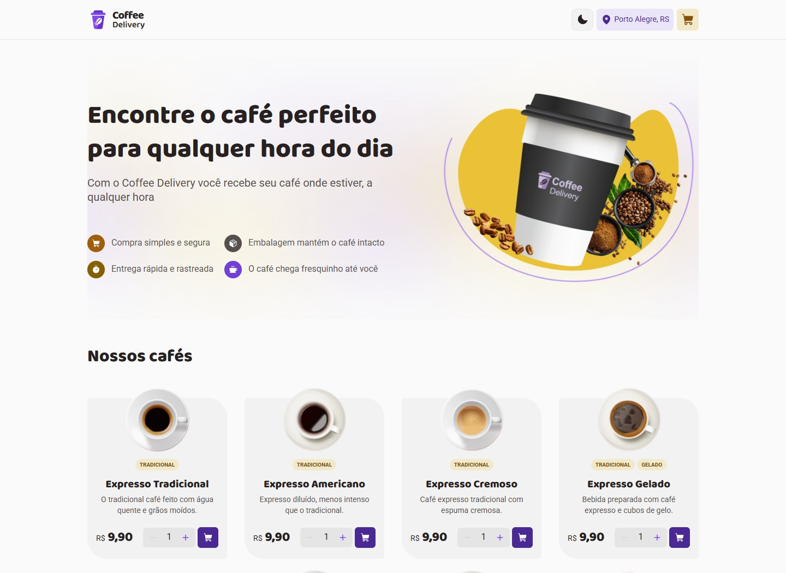

# Coffee Delivery — do catálogo à entrega

Uma cafeteria fictícia para praticar React e TypeScript. O projeto simula um pedido do início ao fim: você escolhe entre 14 cafés, monta o carrinho e informa o endereço de entrega. O CEP é consultado de verdade, mas **não há cobrança nem entrega real**.

**[Acesse o Coffee Delivery na Vercel](https://coffee-delivery-react-type-script-i.vercel.app/).**



## Experimente o pedido

1. Escolha um café, ajuste a quantidade e adicione ao carrinho. Se adicionar o mesmo café novamente, as quantidades se somam na mesma linha.
2. Abra o carrinho e use o CEP `01001-000`. O ViaCEP preenche os campos disponíveis; o número fica por sua conta. Se o serviço estiver indisponível, preencha o endereço manualmente.
3. Escolha crédito, débito ou dinheiro e confirme. Confira o endereço e a forma de pagamento na tela final: o carrinho fica vazio, mas a confirmação continua disponível se você recarregar a mesma aba.

**Capturas do fluxo:** [Checkout no desktop](docs/evidences/checkout-desktop.jpg) · [Confirmação no desktop](docs/evidences/confirmacao-desktop.jpg) · [Home no celular](docs/evidences/home-mobile.jpg) · [Tema escuro no celular](docs/evidences/home-mobile-escuro.jpg) · [Checkout no celular](docs/evidences/checkout-mobile.jpg) · [Confirmação no celular](docs/evidences/confirmacao-mobile.jpg).

## Rodar no seu computador

Use **Node.js 24.15+ na linha 24 LTS** ou **22.22.2+ na linha 22**, além de npm e Git.

```bash
git clone https://github.com/Arthurdias256/Coffee-Delivery-React-TypeScript-IA.git
cd Coffee-Delivery-React-TypeScript-IA
npm ci
npm run dev
```

Abra o endereço mostrado no terminal (normalmente `http://localhost:5173`). Não é necessário configurar um arquivo `.env`.

- `npm run lint`: verifica o código com ESLint.
- `npm run test`: roda a suíte com Vitest e React Testing Library.
- `npm run build`: verifica o TypeScript e gera `dist/`.
- `npm run preview`: serve localmente o resultado do build.

## Por dentro da aplicação

A SPA usa **React, TypeScript e Vite**. O React Router liga as três telas, e o estado é separado de acordo com o que precisa sobreviver a um recarregamento.

| Rota | O que acontece |
| --- | --- |
| `/` | Exibe o catálogo local. O carrinho usa Context API e `useReducer`, é salvo em `localStorage` e conta unidades, não só cafés diferentes. |
| `/checkout` | React Hook Form e Zod validam o endereço e o pagamento. Os valores são calculados em centavos; o frete de R$ 3,50 só é cobrado se houver itens. |
| `/success` | Exibe um snapshot do pedido salvo em `sessionStorage`, independente do carrinho. Sem pedido válido, mostra o estado vazio. |

A interface usa styled-components, CSS responsivo e ícones Phosphor. O tema segue a preferência do sistema até que a pessoa escolha manualmente, e a escolha fica salva.

## O que mudou nesta adaptação

- O checkout agora distingue CEP inexistente de serviço indisponível: o primeiro impede a confirmação; o segundo permite usar um endereço preenchido e validado manualmente.
- O cabeçalho e os controles dos cards foram ajustados, e a marca [Rota do Café](src/assets/branding/marca-rota.svg) substituiu o símbolo anterior no cabeçalho, no favicon e nas estampas do banner e da caixa de entrega.
- O [guia de agentes](AGENTS.md) descreve o fluxo e as regras deste repositório. No OpenCode, a [configuração local](opencode.json) oferece Build, Plan e o perfil `revisao-coffee-delivery`, que não edita arquivos nem executa testes.

O [histórico de testes e evidências](docs/TASKS_SPEC.md#importação--t17t18-evidências-e-hospedagem) registra o fluxo completo no Chrome em seis larguras, de 320 a 1440 px. Para detalhes, consulte os [requisitos](docs/PRD_SPEC.md) e a [especificação técnica](docs/TECH_SPEC.md).

## Referências e publicação

O projeto segue o [enunciado do Projeto Final 05](https://app.notion.com/p/41bdfca74d8d8119a849e30ea492a6af) e o [protótipo no Figma](https://www.figma.com/design/yGPNTA0Yczb183EikXGIiA/Coffee-Delivery-%E2%80%A2-Projeto-Final-React?node-id=2-1550). A origem da implementação-base está documentada no [registro de referências](docs/AI_USAGE.md#registros-do-projeto-base). As fotos dos cafés e a arte-base do banner são da [referência educacional da Rocketseat](https://github.com/rocketseat-education/ignite-challenge-solution-reactjs-coffee-delivery/tree/main/public/images).

A marca Rota do Café foi desenhada em SVG com assistência de IA. Como o gerador visual não produziu uma imagem, a proposta exigida pelo RF-16 segue pendente. As decisões e tentativas estão no [registro de uso de IA](docs/AI_USAGE.md).

O deploy de produção está conectado à branch `main` no GitHub. A Vercel usa o [vercel.json](vercel.json) para servir o build e manter as rotas da SPA funcionando ao recarregar. Veja o [registro de publicação](docs/TASKS_SPEC.md#t18--publicação-na-vercel) para a validação da versão pública.
